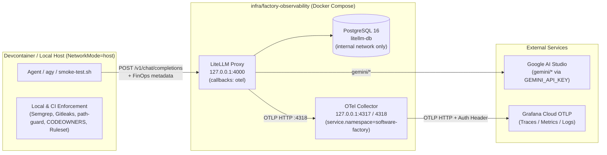

# Implementation Plan: Shed Enforcement Base & Local LiteLLM Observability Plumbing

## Goal Description

Establish the initial **enforcement base** and working **local AI observability stack** for **Shed** (a `.NET 10` cost and carbon auditing and recommendations tool) so that subsequent Builder and Critic agents operate inside a secure, metered, and policy-enforced software factory.

Specifically, this plan delivers two foundational pillars:
1. **Repository Rules, Ruleset Config & CI Security Enforcement:** Close control-plane protection gaps, add `AGENTS.md`, `.gitignore`, `SECURITY.md`, `.github/dependabot.yml`, `.github/workflows/security-checks.yml`, and a version-controlled GitHub Ruleset config (`.github/rulesets/main-protection.json`) backed by a manual branch-protection verification checklist.
2. **Working Local LiteLLM & OpenTelemetry Plumbing:** Fix the container, config-injection, and model-prefix defects in `infra/factory-observability` for Codespaces Docker-outside-of-Docker (DooD) — reading secrets strictly from runtime environment variables (no `.env` or `.env.example` files on disk) — and add repeatable startup + end-to-end smoke-test scripts.



---

## User Review Required

> [!IMPORTANT]
> **No `.env.example` or Filesystem Secret Files:**
> Per your requirement, this plan creates **no `.env.example`** and **never reads `.env` files from disk**. All secrets are documented in [devcontainer.json](file:///workspaces/shed/.devcontainer/devcontainer.json) and injected exclusively via GitHub Codespaces secrets / runtime environment variables. `.gitignore` still ignores `.env` and `.env.*` as a defense-in-depth guardrail.

> [!IMPORTANT]
> **Codespaces Docker-outside-of-Docker (DooD) Config Injection:**
> In this devcontainer, `/workspaces` is mounted from `/var/lib/docker/codespacemount/workspace` on the host, so relative bind mounts in `docker-compose.yml` fail against the host daemon. `docker-compose.yml` will use thin `build.dockerfile_inline` definitions (`FROM <image>` + `COPY <config>`) that stream config files over the Docker socket — portable across Codespaces DooD, local Dev Containers, and Docker Desktop.

> [!NOTE]
> **Control-Plane Edits:**
> This bootstrap milestone intentionally updates control-plane files (`.github/CODEOWNERS`, `.github/workflows/path-guard.yml`, `.github/workflows/security-checks.yml`, `.github/dependabot.yml`, `.github/rulesets/main-protection.json`, `AGENTS.md`, `infra/factory-observability/*`) to complete the enforcement foundation before opening the repo to automated Builder agents.

---

## Proposed Changes

### Pillar 1: Repository Rules, Control-Plane Protection & CI Security

These changes close gaps across `.semgrep.yml`, `.agents/agents/critic.md`, `.github/CODEOWNERS`, and `.github/workflows/path-guard.yml`, commit the repository ruleset config, and establish automated PR enforcement.

#### [NEW] [.gitignore](file:///workspaces/shed/.gitignore)
Add a `.gitignore` covering:
- Secret/environment files (`.env`, `.env.*`, `*.env`) as defense-in-depth so no secret file can ever be accidentally tracked
- `.NET 10` build, test, and mutation-testing artifacts (`bin/`, `obj/`, `TestResults/`, `StrykerOutput/`, `.vs/`, `*.user`)
- OS/editor artifacts (`.DS_Store`, `Thumbs.db`, `*.swp`)

#### [NEW] [AGENTS.md](file:///workspaces/shed/AGENTS.md)
Create the repository-wide AI agent contract already referenced by `.agents/agents/critic.md`, `.github/CODEOWNERS`, and `.github/workflows/path-guard.yml`:
- **Project Scope & Architecture:** Shed (`.NET 10` cost & carbon auditing and recommendations tool) with Clean Architecture boundaries (`src/Domain`, `src/Application`, `src/Infrastructure`, `src/Api`, `src/Worker`, `src/AppHost`, `tests/*`).
- **Protected Control Plane:** Explicit ban on Builder agents editing `.github/`, `.devcontainer/`, `.agents/`, `.semgrep.yml`, `stryker-config.json`, `AGENTS.md`, `docs/FACTORY_ARCHITECTURE.md`, or `infra/factory-observability/`.
- **Secret Hygiene:** Never write secrets or `.env` files to the workspace filesystem; consume only runtime environment variables injected via GitHub Codespaces secrets (documented in `.devcontainer/devcontainer.json`).
- **Security & Reliability Invariants:** Summary of `.semgrep.yml` rules (explicit auth attributes, no interpolated raw SQL, no `DbContext` in Minimal API endpoints, no sync-over-async, no empty catch blocks, no skipped/tautological tests, no hardcoded secrets/TLS bypasses).
- **AI Observability & FinOps Attribution:** Required `metadata` payload (`repo`, `stage`, `issue`, `lane`, `attempt`) when routing calls through LiteLLM (`http://localhost:4000/v1/chat/completions`), and preserving `service.namespace=software-factory`.
- **Pre-PR Verification Protocol:** Run `semgrep --config .semgrep.yml --error .`, `gitleaks detect --source . --redact`, `dotnet test` (once `.NET` solution exists), and invoke the read-only `critic` subagent.

#### [MODIFY] [CODEOWNERS](file:///workspaces/shed/.github/CODEOWNERS)
Update the observability paths on lines 14–15 to match the actual directory in the repository:
```diff
 # Observability & FinOps gateway configuration
-/infra/litellm/ @steve-hawkins
-/infra/otel/ @steve-hawkins
+/infra/factory-observability/ @steve-hawkins
```

#### [MODIFY] [path-guard.yml](file:///workspaces/shed/.github/workflows/path-guard.yml)
Close two control-plane loopholes:
1. Add `\.agents/` and `infra/factory-observability/` to `PROTECTED_REGEX` (matching `critic.md` and `CODEOWNERS`).
2. Validate both `github.actor` (`TRIGGER_ACTOR`) and `github.event.pull_request.user.login` (`PR_AUTHOR`) so re-running a workflow cannot bypass author validation.
```diff
-          PR_AUTHOR: ${{ github.actor }}
+          TRIGGER_ACTOR: ${{ github.actor }}
+          PR_AUTHOR: ${{ github.event.pull_request.user.login || github.actor }}
           BASE_SHA: ${{ github.event.pull_request.base.sha || github.event.merge_group.base_sha }}
           HEAD_SHA: ${{ github.event.pull_request.head.sha || github.event.merge_group.head_sha }}
         run: |
           # Define protected control-plane paths
-          PROTECTED_REGEX='^(\.github/|\.devcontainer/|\.semgrep\.yml$|stryker-config\.json$|AGENTS\.md$|docs/FACTORY_ARCHITECTURE\.md$)'
+          PROTECTED_REGEX='^(\.github/|\.devcontainer/|\.agents/|infra/factory-observability/|\.semgrep\.yml$|stryker-config\.json$|AGENTS\.md$|docs/FACTORY_ARCHITECTURE\.md$)'
```
Require both `PR_AUTHOR == "steve-hawkins"` and `TRIGGER_ACTOR == "steve-hawkins"`.

#### [NEW] [security-checks.yml](file:///workspaces/shed/.github/workflows/security-checks.yml)
Add a minimal-permission (`contents: read`) CI workflow triggered on `pull_request`, `merge_group`, and `push` to `main` with three jobs whose check names match the ruleset config:
1. **`gitleaks`**: Secret scanning across git history and PR diffs using the pinned Gitleaks CLI binary (`v8.21.2`, matching `.devcontainer/base/Dockerfile`, with zero license-key dependency).
2. **`semgrep`**: Runs `semgrep --config .semgrep.yml --validate` and `semgrep --config .semgrep.yml --error .`.
3. **`config-validation`**: Validates all YAML and JSON files (including `.github/rulesets/main-protection.json`), validates `docker compose -f infra/factory-observability/docker-compose.yml config --quiet` with non-secret dummy values, and runs `bash -n` on shell scripts (`.devcontainer/automation/init-firewall.sh`, `infra/factory-observability/*.sh`).

#### [NEW] [main-protection.json](file:///workspaces/shed/.github/rulesets/main-protection.json)
Add a version-controlled GitHub Repository Ruleset configuration (importable in **GitHub → Settings → Rules → Rulesets → Import a ruleset**, and protected under `.github/` by `CODEOWNERS` and `path-guard.yml`):
```json
{
  "name": "Main Branch Protection",
  "target": "branch",
  "enforcement": "active",
  "conditions": {
    "ref_name": {
      "include": ["refs/heads/main"],
      "exclude": []
    }
  },
  "bypass_actors": [
    {
      "actor_id": 5,
      "actor_type": "RepositoryRole",
      "bypass_mode": "pull_request"
    }
  ],
  "rules": [
    { "type": "deletion" },
    { "type": "non_fast_forward" },
    {
      "type": "pull_request",
      "parameters": {
        "required_approving_review_count": 1,
        "dismiss_stale_reviews_on_push": true,
        "require_code_owner_review": true,
        "require_last_push_approval": false,
        "required_review_thread_resolution": true,
        "allowed_merge_methods": ["squash", "merge"]
      }
    },
    {
      "type": "required_status_checks",
      "parameters": {
        "do_not_enforce_on_create": false,
        "strict_required_status_checks_policy": true,
        "required_status_checks": [
          { "context": "path-guard", "integration_id": 15368 },
          { "context": "gitleaks", "integration_id": 15368 },
          { "context": "semgrep", "integration_id": 15368 },
          { "context": "config-validation", "integration_id": 15368 }
        ]
      }
    }
  ]
}
```
*(Note: `bypass_actors` with `actor_id: 5` = Repository Admin and `bypass_mode: "pull_request"` allows you as the solo repo owner to merge your own PRs while still blocking direct pushes to `main` and keeping Builder agent/app PRs gated on review and status checks.)*

#### [NEW] [dependabot.yml](file:///workspaces/shed/.github/dependabot.yml)
Configure weekly automated security/dependency update PRs for `github-actions` and `docker` (`.devcontainer/base` and `infra/factory-observability`).

#### [NEW] [SECURITY.md](file:///workspaces/shed/SECURITY.md)
Document:
- Secret handling policy (zero secrets or `.env` files on the filesystem; variables documented in `.devcontainer/devcontainer.json` and supplied solely via GitHub Codespaces secrets / runtime env vars).
- Egress firewall expectations for headless Builder agents.
- Vulnerability reporting and control-plane governance.

---

### Pillar 2: Local LiteLLM AI Gateway & OpenTelemetry Plumbing

#### [MODIFY] [docker-compose.yml](file:///workspaces/shed/infra/factory-observability/docker-compose.yml)
Fix container config mounts, Codespaces DooD compatibility, port bindings, env vars, and healthchecks:
```yaml
services:
  litellm-db:
    image: postgres:16-alpine
    restart: unless-stopped
    environment:
      POSTGRES_USER: litellm
      POSTGRES_PASSWORD: ${LITELLM_DB_PASSWORD:-litellm-local-dev}
      POSTGRES_DB: litellm
    volumes:
      - litellm_pgdata:/var/lib/postgresql/data
    healthcheck:
      test: ["CMD-SHELL", "pg_isready -U litellm -d litellm"]
      interval: 5s
      timeout: 5s
      retries: 10

  otel-collector:
    build:
      context: .
      dockerfile_inline: |
        FROM otel/opentelemetry-collector-contrib:0.120.0
        COPY otel-collector-config.yml /etc/otelcol-contrib/config.yaml
    restart: unless-stopped
    command: ["--config=/etc/otelcol-contrib/config.yaml"]
    environment:
      GRAFANA_OTLP_ENDPOINT: ${GRAFANA_OTLP_ENDPOINT:?GRAFANA_OTLP_ENDPOINT is required}
      GRAFANA_OTLP_AUTH_HEADER: ${GRAFANA_OTLP_AUTH_HEADER:?GRAFANA_OTLP_AUTH_HEADER is required}
    ports:
      - "127.0.0.1:4317:4317"
      - "127.0.0.1:4318:4318"

  litellm:
    build:
      context: .
      dockerfile_inline: |
        FROM ghcr.io/berriai/litellm:main-stable
        COPY litellm-config.yml /app/config.yaml
    restart: unless-stopped
    depends_on:
      litellm-db:
        condition: service_healthy
      otel-collector:
        condition: service_started
    command: ["--config", "/app/config.yaml", "--port", "4000"]
    environment:
      LITELLM_MASTER_KEY: ${LITELLM_MASTER_KEY:?LITELLM_MASTER_KEY is required}
      LITELLM_SALT_KEY: ${LITELLM_SALT_KEY:?LITELLM_SALT_KEY is required}
      DATABASE_URL: postgresql://litellm:${LITELLM_DB_PASSWORD:-litellm-local-dev}@litellm-db:5432/litellm
      OTEL_SERVICE_NAME: litellm-proxy
      OTEL_EXPORTER: otlp_http
      OTEL_ENDPOINT: http://otel-collector:4318/v1/traces
      OTEL_EXPORTER_OTLP_ENDPOINT: http://otel-collector:4318
      OTEL_EXPORTER_OTLP_PROTOCOL: http/protobuf
      OPENAI_API_KEY: ${OPENAI_API_KEY:-}
      ANTHROPIC_API_KEY: ${ANTHROPIC_API_KEY:-}
      GEMINI_API_KEY: ${GEMINI_API_KEY:-}
    ports:
      - "127.0.0.1:4000:4000"
    healthcheck:
      test: ["CMD-SHELL", "python3 -c \"import urllib.request; urllib.request.urlopen('http://localhost:4000/health/readiness')\""]
      interval: 10s
      timeout: 5s
      retries: 12
      start_period: 20s

volumes:
  litellm_pgdata:
```
*(Note: `litellm-db` is not published on any host port — internal Docker network only — so defaulting `LITELLM_DB_PASSWORD` locally avoids requiring an extra Codespace secret while allowing override via `LITELLM_DB_PASSWORD` if desired.)*

#### [MODIFY] [litellm-config.yml](file:///workspaces/shed/infra/factory-observability/litellm-config.yml)
Fix the provider prefixes to `gemini/` (Google AI Studio via `GEMINI_API_KEY`) and map factory aliases to the confirmed Gemini 3.x / 4 models:
```yaml
model_list:
  - model_name: factory-fast
    litellm_params:
      model: gemini/gemini-3.5-flash-lite
      api_key: os.environ/GEMINI_API_KEY
  - model_name: factory-builder
    litellm_params:
      model: gemini/gemini-4-hydrogen
      api_key: os.environ/GEMINI_API_KEY
  - model_name: factory-complex
    litellm_params:
      model: gemini/gemini-4-carbon
      api_key: os.environ/GEMINI_API_KEY
  # Cross-family Critic (uncomment once ANTHROPIC_API_KEY is added to Codespaces secrets):
  # - model_name: factory-critic
  #   litellm_params:
  #     model: anthropic/claude-sonnet-4-5
  #     api_key: os.environ/ANTHROPIC_API_KEY

litellm_settings:
  callbacks: ["otel"]
  turn_off_message_logging: true
  set_verbose: false
  request_timeout: 120

general_settings:
  master_key: os.environ/LITELLM_MASTER_KEY
  store_model_in_db: true
```
*(During execution, we will verify whether `litellm:main-stable` automatically calculates spend for these Gemini 3.5 / 4 models; if LiteLLM reports zero/unknown cost for any of them, we will add explicit `model_info` per-token pricing fields so FinOps spend tracking in Grafana and Postgres is accurate.)*

#### [MODIFY] [otel-collector-config.yml](file:///workspaces/shed/infra/factory-observability/otel-collector-config.yml)
Add the `debug` exporter (`verbosity: basic`, so no secrets or prompt contents are logged) alongside `otlphttp/grafana` to allow immediate local verification that spans/metrics/logs arrive at the collector and export cleanly to Grafana Cloud.

#### [NEW] [up.sh](file:///workspaces/shed/infra/factory-observability/up.sh)
Executable launcher script that:
1. Reads **exclusively** from runtime environment variables (never sources `.env` files from disk).
2. Validates required environment variables (`LITELLM_MASTER_KEY`, `LITELLM_SALT_KEY`, `GRAFANA_OTLP_ENDPOINT`, `GRAFANA_OTLP_AUTH_HEADER`, and at least one LLM provider key) and confirms `LITELLM_MASTER_KEY` starts with `sk-`.
3. Runs `docker compose -f "$SCRIPT_DIR/docker-compose.yml" up -d --build --wait` and prints service readiness status.

#### [NEW] [smoke-test.sh](file:///workspaces/shed/infra/factory-observability/smoke-test.sh)
Executable end-to-end verification script that:
1. Checks `GET http://localhost:4000/health/readiness` returns HTTP 200.
2. Checks `GET http://localhost:4000/v1/models` with `Authorization: Bearer $LITELLM_MASTER_KEY` lists `factory-fast`, `factory-builder`, and `factory-complex`.
3. Sends a minimal FinOps-tagged `POST http://localhost:4000/v1/chat/completions` to `factory-fast` with `metadata` (`repo`, `stage`, `issue`, `lane`, `attempt`) and asserts HTTP 200 and non-empty assistant content.
4. Waits for the OTel batch flush (5s) and inspects `docker compose logs otel-collector` to confirm spans were received and zero Grafana Cloud export errors (`401`/`403`/`404`/connection failures) occurred.

#### [MODIFY] [README.md](file:///workspaces/shed/README.md)
Update `README.md` to document:
- Shed overview and enforcement base components (`AGENTS.md`, `.semgrep.yml`, Gitleaks, `path-guard.yml`, `security-checks.yml`, `.github/rulesets/main-protection.json`, `critic` subagent).
- Quick-start commands for the local AI observability stack (`./infra/factory-observability/up.sh` and `./infra/factory-observability/smoke-test.sh`), referencing `.devcontainer/devcontainer.json` for required Codespaces secrets.
- Existing FinOps metadata tagging example and `agy` Critic verification instructions.

---

## Verification Plan

### Automated Verification
After implementing the approved plan, we will run all checks directly in the workspace:
1. **Security & Static Enforcement Checks:**
   - `gitleaks detect --source . --redact --verbose` (verify zero leaked secrets in repo/history)
   - `semgrep --config .semgrep.yml --validate` and `semgrep --config .semgrep.yml --error .`
   - `jq empty .github/rulesets/main-protection.json` and YAML parse checks across `.github/` and `infra/factory-observability/`
   - `bash -n .devcontainer/automation/init-firewall.sh infra/factory-observability/up.sh infra/factory-observability/smoke-test.sh`
   - `docker compose -f infra/factory-observability/docker-compose.yml config --quiet`
2. **Live Local LiteLLM + OTel Stack Verification:**
   - Run `./infra/factory-observability/up.sh` and confirm all 3 containers (`litellm-db`, `otel-collector`, `litellm`) start cleanly and pass healthchecks.
   - Run `./infra/factory-observability/smoke-test.sh` and verify:
     - `/health/readiness` returns `200 OK`
     - `/v1/models` returns configured `factory-*` aliases
     - Live tagged completion request to `factory-fast` (and model reachability check for `factory-builder` / `factory-complex`) succeeds with HTTP `200`
     - `otel-collector` logs confirm spans received (`service.namespace=software-factory`) and zero export errors to Grafana Cloud
     - `litellm` logs show zero Prisma/DB, pricing-map, or OTel callback exceptions

### Manual Verification

#### 1. GitHub Branch Protection / Ruleset Verification Checklist (`main`)
After merging or pushing the workflow and ruleset files to `main`, apply `.github/rulesets/main-protection.json` (via **Settings → Rules → Rulesets → New ruleset → Import a ruleset** or manual configuration) and verify every item:

- [ ] **Target Branch:** Ruleset targets `refs/heads/main` (`Default branch`) with **Enforcement status = Active**.
- [ ] **Prevent Destructive Actions:**
  - [ ] **Restrict deletions** is enabled.
  - [ ] **Block force pushes** (`non_fast_forward`) is enabled.
- [ ] **Pull Request Requirements:**
  - [ ] **Require a pull request before merging** is enabled.
  - [ ] **Required approvals** is set to `1`.
  - [ ] **Dismiss stale pull request approvals when new commits are pushed** is enabled.
  - [ ] **Require review from Code Owners** is enabled (and `.github/CODEOWNERS` shows green/valid syntax in GitHub UI).
  - [ ] **Require conversation resolution before merging** is enabled.
- [ ] **Required Status Checks (after first workflow run on a PR):**
  - [ ] **Require status checks to pass** and **Require branches to be up to date before merging** are enabled.
  - [ ] `path-guard` (GitHub Actions) is listed as required.
  - [ ] `gitleaks` (GitHub Actions) is listed as required.
  - [ ] `semgrep` (GitHub Actions) is listed as required.
  - [ ] `config-validation` (GitHub Actions) is listed as required.
- [ ] **Solo-Maintainer Bypass Safety:**
  - [ ] **Repository admin** bypass is set to **Pull request only** (`bypass_mode: "pull_request"`) so you can merge your own PRs on this solo repo while direct pushes to `main` remain blocked and automated/bot PRs cannot bypass checks.
- [ ] **GitHub Security Features (Settings → Code security):**
  - [ ] **Secret scanning** and **Push protection** are enabled.
  - [ ] **Dependabot alerts** and **Dependabot security updates** are enabled.

#### 2. Grafana Cloud OTLP Trace Verification
- [ ] Open **Grafana Cloud → Explore → Tempo (Traces)** and filter by `resource.service.namespace = "software-factory"` (or `service.name = "litellm-proxy"`) to confirm the smoke-test trace and `metadata.*` FinOps attributes (`repo`, `stage`, `issue`, `lane`, `attempt`) appear.
- [ ] Reload the Codespace (**Command Palette → `Codespaces: Reload to Apply Changes`**) so the container shell picks up your updated `GRAFANA_OTLP_AUTH_HEADER` secret directly.
